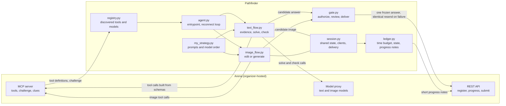

# AirClaw Pathfinder

**An agent that enters an environment it has never seen, discovers what it can use, finishes the task, and returns evidence of what it did.**

Entry for the NVIDIA Developer Live Agent Gauntlet · Python 3.12 · Agent ID `team-airclaw-pathfinder`

Pathfinder discovers the tools and models the arena exposes, gathers evidence for the task, and routes every final submission through a policy and release gate. It handles text and image challenges, with per-clue checking, model fallback, and reconnect handling.

---

## Contents

1. [The problem](#the-problem)
2. [Architecture](#architecture)
3. [One run, step by step](#one-run-step-by-step)
4. [The gate: three separate decisions](#the-gate-three-separate-decisions)
5. [What the starter kit provides and what Pathfinder adds](#what-the-starter-kit-provides-and-what-pathfinder-adds)
6. [Design decisions](#design-decisions)
7. [Project outline](#project-outline)
8. [Testing](#testing)
9. [Results](#results)
10. [Verify and run](#verify-and-run)

---

## The problem

A developer can have access to a new platform and still lose hours working out which tools matter, what each one needs, and why a call failed. Pathfinder is a small, inspectable answer to that: **discover first, act second, show your work.**

The Gauntlet is the test bed. The part meant to carry over to other platforms is the loop itself: discover, plan, act, verify, report.

## Architecture



The solver proposes; the gate decides. Nothing reaches the arena as a final answer except through `gate.py`.

## One run, step by step

1. **Register once.** The identity is fixed for the whole round. A dropped connection later reconnects under the same identity and never registers again.
2. **Discover.** Ask the arena which tools and models exist right now. Each tool's declared inputs are kept so calls can be built from them. A call that cannot be filled correctly is skipped, not guessed.
3. **Read the task.** Wait for the round to start, then read the challenge and its clues.
4. **Gather evidence.** Use every tool the challenge lists as required or names in its text, built from its schema. Identical calls are made once. A listed tool this server does not offer is recorded, left out of the required list, and never blocks the answer. A listed tool that is offered but was skipped does block it (see the gate below).
5. **Solve.**
   - *Text:* the model writes short working, then a final `ANSWER:` line.
   - *Image:* edit when there is a source image, generate otherwise. The prompt restates what must not appear.
6. **Check.** For clue-based tasks a second pass tests the answer against each clue and says only PASS or FAIL. After a FAIL the model re-solves with the failed clues as feedback, and the new answer is used only if it passes its own check. Otherwise the original is sent as it was, and the failed check is only noted in the progress messages and the run record.
7. **Gate.** The candidate is reviewed, frozen, and sent.
8. **Narrate.** Short progress notes throughout say what the agent is doing and why. They carry no credentials and no raw model reasoning.

If a model returns nothing usable, the next model in the ranking is tried while time allows. If the running task turns out to be a different type than detected, the agent switches tools instead of failing. A late answer is still sent, because it is still judged for quality and only loses its speed score.

## The gate: three separate decisions

| Question | Where | Decisions |
|---|---|---|
| May this action be attempted at all? | `Policy.authorize` | `ALLOW` or `DENY` |
| Is the final candidate fit to send now? | `ReleaseGate.review` | `RELEASE` or `HOLD` |
| What happened when it was sent? | `ReleaseGate.deliver` | `SUCCESS`, `RETRY` or `ESCALATE` |

- **Authorize.** Known challenge capabilities are allowed. A tool the challenge names is allowed. Any other tool, and any action class with no defined policy, is denied. The wrong identity or an origin outside the configured arena is denied. Each tool has a call budget, and the policy object is frozen once the run starts, so the solver and its tools have no path to change it.
- **Review.** Holds answers that are empty, contain tool or reasoning markup, skip a required tool that the server does offer, or are blank images. A required tool the server does not offer is not counted as skipped; it is reported instead. A sent-as-is input image is released with a caveat, not presented as a verified edit. Running short of time adds a caveat but never blocks a send.
- **Deliver.** The first answer is frozen. A different answer for the same round is refused. If delivery is uncertain, only the identical payload is resent. A 409 means the arena already holds an answer for this round, so the attempt ends without sending anything new. An identical resend leaves the answer unchanged; whether the server also avoids processing it twice is up to the server.
- **Audit.** Each decision is appended to a hash-chained log. `intact()` recomputes the chain, so an edit to any single entry is detected. A rewrite of the whole chain would not be, because the log is not signed.
- **Protected changes (extra safeguard).** `review_protected_change` is a separate check for changes to the system the agent runs in. The Gauntlet tasks never need one, so the text and image flows do not call it. It is covered by unit tests only.

## What the starter kit provides and what Pathfinder adds

The competition supplies a starter kit: the REST and MCP clients, the proxy headers, the packager, and an example agent that solves once and submits. Pathfinder keeps those client contracts intact and builds its own agent on top.

| | Starter kit | Pathfinder |
|---|---|---|
| Connecting, registering, submitting | REST and MCP clients | Same clients, unmodified |
| Packaging and readiness checks | Packager and `doctor` | Same tools, unmodified |
| Run loop | Single pass: solve, then submit | Own entrypoint with state, a time budget, and reconnect handling |
| Tool use | Tries payload shapes until one is accepted | Calls built from each tool's declared inputs, including the challenge's required list |
| Answer format | Answer on the first line | Short working first, answer on the last line |
| Checking | None | Per-clue PASS/FAIL audit with guarded correction |
| Final submission | Direct call | Through one gate that freezes the answer and controls retries |
| Models | First in roster order | Ordered by measurement, applied only to models actually present |
| Reconnect | Not handled | Reconnects under the same identity and resends the frozen answer |

The idea behind the design, treating unfamiliar tools as something to discover, check against and report on rather than assume, is the author's own. The code under `pathfinder/` and the strategy in `my_strategy.py` were written for this entry.

## Design decisions

- **Working first, answer last.** On one medium logic puzzle, answer-first was right on 2 of 8 tries and working-first on 8 of 8, for roughly 180 extra tokens. This is an observation on a single puzzle, not a general claim.
- **Corrections must pass their own audit.** An early version let the checker rewrite answers, and on one run it turned a correct answer into a wrong one. The checker now only judges, and a correction is adopted only if it passes its own audit. That reduces the risk but cannot remove it, because the same kind of model does the judging.
- **Models ordered by measurement.** The order applies only to models in the live roster, so a changed roster cannot break it. Image generation uses the larger image model. Editing uses the lighter one, which scored the same there and finished sooner.
- **Tool calls built from schemas** instead of trying shapes until one works.
- **A late answer is still sent.** It is judged for quality and only loses its speed score, so staying silent can only cost more.
- **A custom entrypoint** because the starter's strategy hooks cannot veto a submission, and the gate has to sit on every final route.
- **Left out on purpose:** a dashboard, a voice interface, and multi-tenant deployment. None of them affects the score this round.

## Project outline

This repository holds the packaged agent as a single archive, as the submission format requires.

```
team-airclaw-pathfinder-submission/
├── README.md                                          this file
├── team-airclaw-pathfinder-submission.tar.gz          the packaged agent
└── team-airclaw-pathfinder-submission.tar.gz.sha256   its SHA-256 checksum
```

Inside the archive (`gauntlet-submission/`, 24 files plus the manifest):

```
gauntlet-submission/
├── submission.json            manifest: entrypoint, runtime, file list
├── requirements.lock          hash-locked dependencies
│
├── pathfinder/                new for this entry
│   ├── agent.py               entrypoint, connection handling, reconnect loop   (97 lines)
│   ├── session.py             shared state, clients, delivery, run records      (193)
│   ├── text_flow.py           evidence gathering, solving, per-clue check       (196)
│   ├── image_flow.py          edit or generate, model fallback                  (111)
│   ├── gate.py                policy, release review, frozen delivery, audit    (310)
│   ├── registry.py            discovered tools and models, model ranking        (143)
│   ├── ledger.py              time budget, task state, observer, reconnect      (137)
│   └── parsing.py             reading answers, verdicts, and tool results       (51)
│
├── my_strategy.py             replaced: prompts, model order, image prompts     (113)
│
├── base_strategy.py           starter kit, unmodified
├── model_selector.py          starter kit, unmodified
└── arena_clients/             starter kit, unmodified
    ├── config.py              environment and URL resolution
    ├── http_client.py         REST client
    ├── mcp_client.py          MCP client
    ├── proxy_headers.py       usage attribution headers
    ├── session_monitor.py     stop detection
    ├── display.py, outputs.py run records and output files
    ├── doctor.py              readiness and rehearsal checks
    ├── package.py             packager
    └── submission.schema.json manifest schema
```

Entrypoint: `python pathfinder/agent.py`. The archive contains no tests, logs, outputs, or credentials.

## Testing

60 automated tests (kept out of the archive, per the packaging rules) run without network access, with the arena and the models replaced by scripted fakes.

- **Gate and policy:** allow and deny rules, per-tool call budgets, an immutable policy, release review for text and images, strict handling of protected changes, a tamper-evident audit log, and identical-payload resend.
- **Whole-agent behavior under failure:**
  - a lost submit response, and a 409 conflict;
  - a closed lobby, and a reconnect that resends the frozen answer instead of starting over;
  - malformed, empty, or crashing tool results;
  - a required tool the server does not offer;
  - instructions hidden in a tool result, which have no effect on the policy or the answer;
  - a short or already-passed deadline, and malformed time replies;
  - models that return nothing, and every model failing;
  - each outcome of the per-clue check;
  - image models that return nothing or fail, the input-image fallback, a blank result that is held, an MCP submit failure that falls back to REST, and a heat that turns out to be text.

The archive and this repository do not include the test files, which are kept out of the package by its rules. The tests were also checked by breaking the code on purpose: reintroducing a time-based hold, adopting an unaudited correction, and forgetting the frozen answer each made tests fail.

## Results

Logged runs of the final version on the shared Practice arena, which has five synthetic puzzles. The text runs used the ranked text models in the order given above; images used the larger image model to generate and the lighter one to edit.

| Task | Runs | Quality | Final score | Unmodified starter |
|---|---|---|---|---|
| Text logic puzzles | 25 | 100 in 24 of 25; the miss scored 50 on the hard puzzle | 96.2 to 98.6 on the correct runs; 62.7 on the miss | 95.9 and 98.0 (small reference sample, 2 runs) |
| Image generate | 10 | 79 to 94 | 82.4 to 93.4 | 86.5 (1 run) |
| Image edit | 13 | 77 to 89 | 83.0 to 91.2 | 88.0 (1 run) |

These are small samples on a practice set, so they show the agent works end to end and holds up under repeated runs. They do not show how it will rank against other entries.

Scoring weights (defaults): quality 70%, speed 15%, tool coverage 10%, token efficiency 5%. Tool coverage and token efficiency were 100 and 99 in every run, so the remaining headroom is image quality and speed.

## Verify and run

Check the archive:

```
shasum -a 256 -c team-airclaw-pathfinder-submission.tar.gz.sha256
```

The archive expands to `gauntlet-submission/`. Extract it and work from inside that folder:

```
tar xzf team-airclaw-pathfinder-submission.tar.gz
cd gauntlet-submission
```

The agent reads `ARENA_SERVER`, `ARENA_API_KEY` and `AGENT_ID` from the environment and needs no `.env` file. It also runs from a read-only folder, skipping only its local run records. Install from the lock without downloading floating versions:

```
python3.12 -m pip install --require-hashes -r requirements.lock
python pathfinder/agent.py
```
